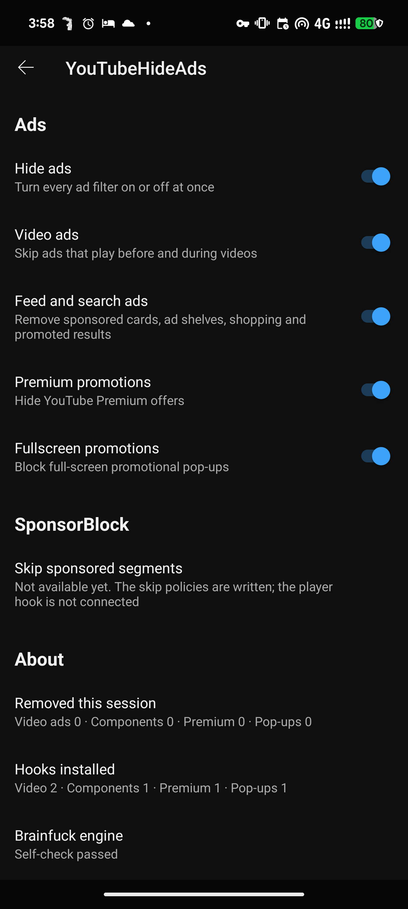

<div align="center">


# YouTube Hide Ads

**An Xposed module that removes ads from YouTube, with every decision written in Brainfuck and the rest in XAX. Yes, really.**

Ads, sponsored Shorts and promotions are taken out before YouTube shows them, and SponsorBlock segments are skipped.

<br>

[](https://github.com/MrxSiN/YouTubeHideAds/releases)
[](https://github.com/MrxSiN/YouTubeHideAds/releases)
[](#requirements)
[](https://github.com/libxposed/api)

</div>

---

> [!NOTE]
> YouTube renames its obfuscated classes with almost every update. The module finds its targets
> again by shape at each start. When a role is missing or ambiguous, it leaves that feature alone
> rather than guess. See the [compatibility](#compatibility) table for what has actually been tested.

## Why Brainfuck? And what is XAX?

Surely nobody would write the decision logic of an ad blocker in Brainfuck.

Brainfuck was chosen for its thriving ecosystem, its world-class IDE support and its famously
self-documenting syntax. XAX was chosen because Kotlin felt too mainstream.

Just joking.

The idea is the same as in [Threads Hide Ads](https://github.com/MrxSiN/ThreadsHideAds), taken one
step further: **keep every decision out of the code that touches YouTube, and keep conventional
languages out of the repository altogether.**

- **Brainfuck decides.** Whether this component is an ad, whether Premium marketing may go, whether
  the player may seek to the end of this sponsor segment, whether a swipe is a brightness change.
  Brainfuck cannot call Android, Xposed, DexKit or JNI. It reads bytes and writes bytes, and the host
  acts only on an exact successful reply.
- **XAX does everything else.** Hooks, DexKit discovery, reflection, the settings page, HTTPS and
  JSON for SponsorBlock are one canonical [XAX](https://github.com/MrxSiN/XAX) semantic store. The
  external XAX compiler turns it into DEX and signs the APK. There is no Java, Kotlin, C, Python or
  shell application source in this repository.

It is not slow either. The nine policies are compiled ahead of time to AArch64 shared libraries by
[brainfuckC](https://github.com/MrxSiN/brainfuckC). There is no interpreter in the APK.

|  | |
|---|---|
| 🧹 **Removed, not hidden** | Ad components are replaced before YouTube lays them out, and sponsored Shorts leave the feed before the pager is built, so there are no blank slots or frozen clips. |
| ⏭️ **SponsorBlock built in** | A privacy-preserving hash-prefix lookup, and a seek that Brainfuck authorizes and the host checks again against the current video. |
| 🔎 **Survives renames** | DexKit finds every hook by structure at each start. A missing or ambiguous role installs nothing for that feature. |
| 🧠 **Policy in Brainfuck, compiled** | Nine hand-written programs compiled to native code, and 531 self-checks against the packaged libraries at every start. |
| 🛟 **Fails closed** | If a self-check fails, that feature stays off. Network errors and unknown playback types never seek. |
| ⚙️ **Native-looking settings** | A YouTube-style page under **You → Settings → YoutubeHideAds**, with every switch independent. |

---

## What it removes

<div align="center">

</div>

| Group | Setting | Default |
|---|---|---|
| Ads | Video and Shorts ads · Feed and search ads · Premium promotions · Fullscreen promotions | On, under the **Hide ads** master switch |
| SponsorBlock | Sponsor, self-promotion | On |
| SponsorBlock | Interaction, intro, outro, preview, filler, music off-topic | Off |
| Content | Playables (game shelves, cards, Explore entry) | Hidden |
| Feed | Preview videos · Explore more topics · Posts | Hidden |
| Feed | Shorts in feeds | Shown |
| Feed | AI channels · Likely AI channels ([AiSList](https://github.com/Override92/AiSList)) | Off |
| Player | Swipe brightness (left) · Swipe volume (right), fullscreen only | On |
| Player | Force original audio on multi-language videos | On |

Turning **Hide ads** off does not disable the content and player features. Reload a feed after
changing its switches. Original audio applies to the next track list and respects a manual choice.
Full table: [settings and defaults](docs/README.md#settings-and-defaults).

<details open>
<summary><b>🧱 Where each removal happens</b></summary>
<br>

| Surface | Where | What it does |
|---|---|---|
| **Video ads** | player ad activation and ad layout | Suppresses the ad slot when Brainfuck confirms a structural ad fact and a safe transition. |
| **Feed, search and shopping ads** | the component parser, found by DexKit | Replaces a confirmed paid component with YouTube's own empty component. |
| **Sponsored Shorts** | Shorts response, insertion and pager seed | Removes video/image ad entries together with their tracking data, before the pager exists. |
| **Premium, fullscreen, panels** | offer view, fullscreen dialog, engagement panel by typed identifier | Hides marketing surfaces without touching entitlement or subscription management. |
| **Feed sections, Playables, AI channels** | the same component hook | Removes only the matched section or card; channel rows and playlists stay. |
| **SponsorBlock** | player seek and duration bridges | Fetches by hash prefix once per playback, then seeks to the segment end after Brainfuck authorizes it. |

</details>

---

## Status

**v1.0.0**, the first public release. The seven three-input gates share one native library, and the
package is now `io.github.mrxsin.youtubehideads`. Earlier development builds are summarized in the
[changelog](CHANGELOG.md).

### Compatibility

Each row is one setup somebody has actually run. If you try another, please open a pull request
adding a row.

| Device | Android | Framework | YouTube | Module | Result | Tester | Date |
|---|---|---|---|---|---|---|---|
| Pixel 8 Pro | 17 | Vector 2.2 (API 102) | 21.41.525 | 1.0.0 | 531 self-checks pass, every hook installed, installed digest matches | @MrxSiN | 2026-10 |
| Pixel 8 Pro | 17 | Vector 2.2 (API 102) | 21.41.525 | dev 77 | AI/audio off/on, advancing video, live ad, Shorts, Playables and feed removal, SponsorBlock seeks, swipes | @MrxSiN | 2026-10 |

### Known limits

- Premium, fullscreen and panel promotions passed controlled hook tests. Naturally delivered
  positives have not been seen yet.
- Preview-video and Explore-more-topics headings are matched in English only.
- AI lists are community-maintained and can misclassify channels, which is why they default off.
- SponsorBlock has no retry, no cross-video cache, no submissions and no colored seekbar.
- arm64-v8a only. No other YouTube version, device or LSPatch setup has been tried.

Details: [feature coverage](docs/FEATURE_COVERAGE.md) and [compatibility](docs/COMPATIBILITY.md).

## Requirements

| | |
|---|---|
| **Android** | 9.0 (API 28) or newer, arm64 |
| **App** | YouTube (`com.google.android.youtube`) |
| **Framework** | [Vector](https://github.com/JingMatrix/Vector) or LSPosed with libxposed API 102 |
| **Root** | Required by Vector/LSPosed; the module itself requests no permissions |

## Install

```
1. Install the APK from Releases or the Xposed module repository
2. Enable YoutubeHideAds in Vector or LSPosed, scoped to YouTube
3. Force-stop YouTube once, then open it
```

Get it from [GitHub Releases](https://github.com/MrxSiN/YouTubeHideAds/releases) or
[modules.lsposed.org](https://modules.lsposed.org/module/io.github.mrxsin.youtubehideads). Settings
are under **YouTube → You → Settings → YoutubeHideAds**. Preferences and AI caches live in
YouTube's own data, so clearing YouTube data resets them.

If you used a development build (`org.youtubehideads.module`), uninstall it first. Your settings
carry over.

The framework log shows what happened, in lines beginning with `YouTubeHideAds:`:

```text
Ad policy self-check passed (70 cases)
SponsorBlock self-check passed (277 cases)
Ad component hook installed
Shorts feed removal hooks installed (paired, insert, response, restore, seed)
Video ad suppressed
```

---

## How it works

```
YouTube process
  XAX module (DEX) ──────────────► Bfp1Bridge.run ──JNI──► lib<policy>.so
  hooks, DexKit roles               input bytes            nine AOT Brainfuck policies
  settings page, HTTPS/JSON              ▲                       │
  typed actions                          │   exact reply only    │
                                         └───────────────────────┘
```

One rule decides where code goes: **if it touches YouTube, Android, the network or JNI, XAX does it;
if it decides whether to act on what XAX found, Brainfuck decides.**

<details>
<summary><b>The Brainfuck policies</b></summary>
<br>

| Library | Decides |
|---|---|
| `settings_snapshot` | ad switch defaults and the master gate |
| `sponsor_settings` | SponsorBlock category defaults and gating |
| `ad_component` | a component from 54 structural facts: suppress or pass |
| `ad_panel` · `ad_fullscreen` | engagement-panel and fullscreen promotions |
| `suppress_video_slot` | a player ad slot, given a safe transition |
| `sponsor_time_window` | whether `start <= current < end`, on three 64-bit timestamps |
| `sponsor_skip_pipeline` | category, generation, window and playback type, then echoes the seek endpoint |
| `and3` | own switch AND fact AND valid context, shared by Premium, Shorts, Playables, swipes, feed sections, AI channels and original audio |

Each call gets a fresh 4,096-byte tape, a 64-byte output buffer and a 2,000,000-loop budget. Byte
layouts are in [`docs/BRAINFUCK_ABI.md`](docs/BRAINFUCK_ABI.md), source conventions in
[`docs/BRAINFUCK_SOURCE_STYLE.md`](docs/BRAINFUCK_SOURCE_STYLE.md).

</details>

<details>
<summary><b>Finding the hooks</b></summary>
<br>

DexKit runs once per process and resolves typed roles by structure: component parser and
serializer, player seek and duration bridges, Shorts response and pager seed, the original-audio
controller. Each role must match exactly one target. Anything missing or ambiguous leaves its feature
off, and the log says so. See [`docs/DEXKIT_RESOLUTION.md`](docs/DEXKIT_RESOLUTION.md).

</details>

<details>
<summary><b>SponsorBlock without leaking what you watch</b></summary>
<br>

Only a four-hex-digit SHA-256 prefix of the video ID leaves the device. The response is bounded to
256 KiB, 1,024 records and 100 segments, with 4-second timeouts and redirects disabled. Before a seek,
the main thread checks the player instance, video ID and playback generation again. Live streams and
unknown playback types never seek. See [`docs/SPONSORBLOCK_API_RESEARCH.md`](docs/SPONSORBLOCK_API_RESEARCH.md).

</details>

---

## Build

There is no build script in this repository. A release is built with external tools:

```text
brainfuckC   source/**/*.bf  ->  lib<policy>.so (AArch64)
AAPT2        source/branding ->  branding.apk (static resources only)
XAX          source/xax/youtubehideads.xax + pinned inputs -> signed APK
```

Every input is pinned by BLAKE3 in the store, so a mismatched input fails the build. Rebuilding
requires the retained XAX snapshot with the branding-v2 extension; a clean checkout of its base commit
is not enough. Steps and identities are in [`docs/BUILD.md`](docs/BUILD.md) and
[`evidence/release_20261018`](evidence/release_20261018/README.md).

Publishing a GitHub release mirrors its APK to
[Xposed-Modules-Repo](https://github.com/Xposed-Modules-Repo/io.github.mrxsin.youtubehideads) through
[`xposed-sync.yml`](.github/workflows/xposed-sync.yml).

## Design

```
source/brainfuck/          and3, video slot, SponsorBlock window and pipeline
source/brainfuck-runtime/  settings snapshots, ad component, panel and fullscreen policies
source/xax/                the canonical XAX store: hooks, discovery, settings, network, actions
source/branding/           manifest, label and adaptive icon (static XML)
contracts/                 input byte orders for the component, feed, swipe, AI and audio gates
testdata/                  fixtures recorded for the startup self-checks
evidence/                  dated build identities and device logs
docs/                      architecture, ABI, build, testing and compatibility
```

The layering is in [`docs/ARCHITECTURE_BRAINFUCK_XAX.md`](docs/ARCHITECTURE_BRAINFUCK_XAX.md) and
[`docs/LANGUAGE_BOUNDARY.md`](docs/LANGUAGE_BOUNDARY.md); the full index is [`docs/README.md`](docs/README.md).

## Troubleshooting

| Problem | Try |
|---|---|
| No module log lines | Check that the module is enabled with YouTube in scope, then force-stop YouTube. |
| `UnsatisfiedLinkError` right after an update | Let the install settle, then force-stop and reopen YouTube. The manager can briefly keep the old APK path. |
| A self-check reports `false` | That feature stays off. Report the `YouTubeHideAds:` log lines. |
| A feed switch seems ignored | Reload the feed; removals apply to newly loaded components. |
| Broken after a YouTube update | YouTube may have changed its internal classes. Report the log lines with the YouTube version. |

## Credits

| Project | Contribution |
|---|---|
| [DexKit](https://github.com/LuckyPray/DexKit) by LuckyPray | Structural discovery of obfuscated classes and methods (Apache-2.0). |
| [libxposed API](https://github.com/libxposed/api), [Vector](https://github.com/JingMatrix/Vector), [LSPosed](https://github.com/LSPosed/LSPosed) | The hooking API and frameworks the module runs on. |
| [XAX](https://github.com/MrxSiN/XAX), [XAX-MCP](https://github.com/MrxSiN/XAX-MCP), [brainfuckC](https://github.com/MrxSiN/brainfuckC) | External compilers for the store and the policies. |
| [SponsorBlock](https://sponsor.ajay.app) | Community segment data. |
| [Override92/AiSList](https://github.com/Override92/AiSList) | Optional AI-channel lists, CC BY-NC 4.0, not bundled ([aisloplist.com](https://aisloplist.com)). |
| [Morphe Patches](https://github.com/MorpheApp/morphe-patches) | Behavior reference; no implementation copied. |

Newly authored project material is GPL-3.0-or-later. See [NOTICE](NOTICE) and
[upstream provenance](docs/UPSTREAM_PROVENANCE.md) for third-party terms.

## Disclaimer

Not affiliated with, endorsed by or sponsored by Google LLC or YouTube. Provided for educational and
personal use. YouTube updates may break the hooks without notice.
