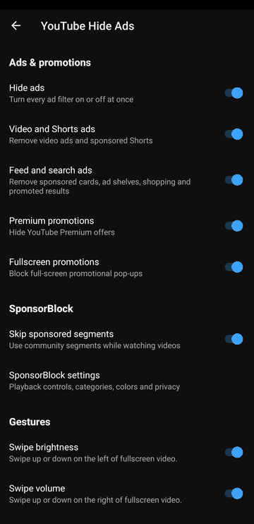
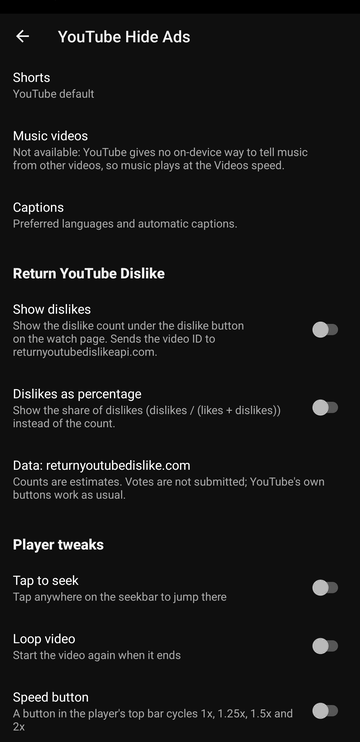
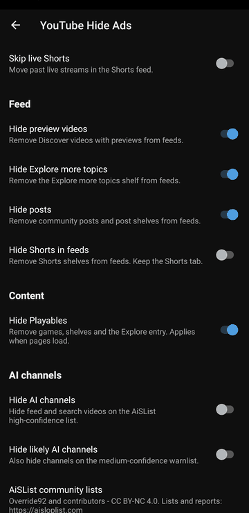

# YouTube Hide Ads

**English** · [简体中文](README.zh-CN.md) · [繁體中文](README.zh-TW.md) · [Español](README.es.md) · [Português](README.pt.md) · [Русский](README.ru.md) · [日本語](README.ja.md) · [한국어](README.ko.md) · [Bahasa Indonesia](README.id.md) · [Bahasa Melayu](README.ms.md)

**An Xposed module that removes ads from YouTube, with every decision written in Brainfuck and the rest in XAX.**

## Features

- **Ads removed before they show:** video and Shorts ads, feed and search ads, Premium and fullscreen promotions. No blank slots.
- **SponsorBlock built in**, with colored segments on the seekbar and a player button for manual skip, voting and submissions.
- **Player:** default speed and quality, preferred caption languages, background playback, original audio, remember live position, tap to seek, loop, a speed button, and the Return YouTube Dislike count.
- **Gestures:** swipe brightness on the left and volume on the right in fullscreen, never over live chat, panels or the More videos sheet.
- **Feed:** hide Shorts shelves, posts, previews, Playables and AI channels, a channel and keyword blacklist, and DeArrow thumbnails.
- **Shorts:** hide individual buttons and panels, and skip live Shorts.
- **One settings page** under **You → Settings → YouTube Hide Ads**, in YouTube's language (10 languages).

The new extras are off by default. Every setting and its default is listed in [docs](docs/README.md#settings-and-defaults).

## Install

1. Get the APK from [Releases](https://github.com/MrxSiN/YouTubeHideAds/releases) or [modules.lsposed.org](https://modules.lsposed.org/module/io.github.mrxsin.youtubehideads).
2. Enable it in [Vector](https://github.com/JingMatrix/Vector) or LSPosed (libxposed API 102) with YouTube in scope.
3. Force-stop YouTube and open it again.

Needs Android 9 or newer on arm64, and root for the framework. The module itself asks for no permissions.

## Compatibility

| YouTube | Module | Status |
|---|---|---|
| 21.45.88 | 1.3.0 (build 157) | ✅ Working |
| 21.43.523 | 1.2.0 | ✅ Working |
| 21.42.243 | 1.1.0 | ✅ Working |

Tested on a Pixel 8 Pro with Android 17 and Vector 2.2. YouTube renames its internal classes in most
updates. The module finds its targets again by their structure, and turns a feature off rather than guess
when it can't. History: [changelog](CHANGELOG.md) · details: [compatibility](docs/COMPATIBILITY.md).

## Known limits

- HTTPS-filtering apps such as AdGuard can block SponsorBlock, the update check, dislike counts and DeArrow; see [below](#sponsorblock-or-update-check-never-connects).
- DeArrow replaces thumbnails, not titles. YouTube's own speed menu still shows 1x after a default speed is applied.
- Default quality on mobile data, live Shorts and automatic-caption blocking have not been tested on a phone.
- Checked in dark theme on one phone only. New 1.3.0 text is in English.

Everything tested and untested: [feature coverage](docs/FEATURE_COVERAGE.md).

## Troubleshooting

| Problem | Try |
|---|---|
| No `YouTubeHideAds:` lines in the framework log | Check that YouTube is in scope, then force-stop it. |
| A feed switch seems ignored | Reload the feed. |
| Broken after a YouTube update | Use **About → Compatibility & diagnostics → Report a problem**. |

### SponsorBlock or update check never connects

This also covers dislike counts and DeArrow. The log shows `NOT_ENOUGH_SCTS`. An HTTPS-filtering app is re-signing the connection, and YouTube's
certificate-transparency check refuses it. In AdGuard, add these to **HTTPS filtering → Exclusions**:
`sponsor.ajay.app`, `github.com`, `returnyoutubedislikeapi.com`, `dearrow-thumb.ajay.app`. Then restart YouTube.

## How it works

Brainfuck decides and XAX acts. Nine Brainfuck policies decide, for example, whether a component is an
ad, whether a seek may skip a segment, or whether a touch is a swipe. They are compiled ahead of time to
AArch64 by [BBC](https://github.com/MrxSiN/BBC). Hooks, discovery, settings and networking are one
[XAX](https://github.com/MrxSiN/XAX) store, compiled to DEX. The repository has no Java, Kotlin or C
application source.

[Architecture](docs/ARCHITECTURE_BRAINFUCK_XAX.md) · [build](docs/BUILD.md) · [all docs](docs/README.md) · [evidence](evidence/README.md)

## Support

If the module is useful to you, you can [sponsor its development](https://github.com/sponsors/MrxSiN).

## Credits and license

[DexKit](https://github.com/LuckyPray/DexKit), [libxposed](https://github.com/libxposed/api),
[Vector](https://github.com/JingMatrix/Vector), [SponsorBlock](https://sponsor.ajay.app),
[Return YouTube Dislike](https://returnyoutubedislike.com), [DeArrow](https://dearrow.ajay.app),
[AiSList](https://github.com/Override92/AiSList) (CC BY-NC 4.0, not bundled), and
[Morphe Patches](https://github.com/MorpheApp/morphe-patches), used as a behavior reference
([notice](LICENSES/Morphe-NOTICE.txt)).

GPL-3.0-or-later. See [NOTICE](NOTICE) and [upstream provenance](docs/UPSTREAM_PROVENANCE.md).
This project is not affiliated with Google or YouTube.
