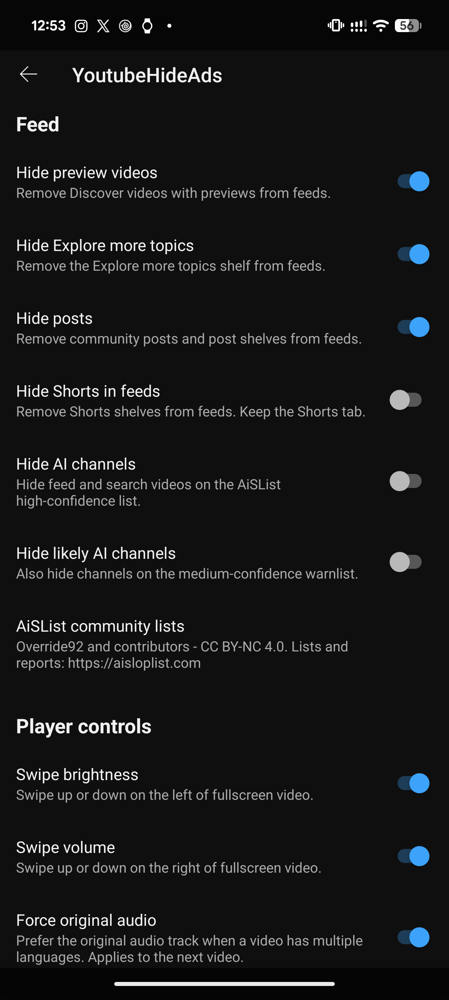

# Branding, AI channel filtering and original audio - 2026-10-18

Build **77** is the canonical and installed build. Testing started on October 17 and final settings,
installed identity and cold-start checks finished October 18 (Asia/Kuala_Lumpur). Device:
Pixel 8 Pro, Android 17, YouTube 21.41.525, Vector 2.2 / API 102.
[Exact build](build.json), [device checks](device-checks.json), [external compiler](toolchain.json),
[final verification](verification.json), [APK resources](apk-resources.txt).

## Delivered

- App and settings title: **YoutubeHideAds**. Static description: “Minimal LSPosed module that hides
  YouTube ads and unwanted feed content.” Independently drawn white struck-through shield and
  YouTube mark on black follows the ThreadsHideAds/TwitterHideAds icon style. Adaptive and
  monochrome icons ship; no launcher is added. [App info, build 75](branding75-app-info.png).
- **Hide AI channels** and **Hide likely AI channels** independently select AiSList's high-confidence
  blocklist and medium-confidence warnlist. Both default off. The filters apply to supported own
  video/Shorts cards in Home/related and search; channel rows, playlists, comments and protected
  library/subscription contexts are preserved. Reload already rendered feeds after changing a switch.
- **Force original audio** defaults on. For a fresh multi-language track list/controller, the unique
  non-auto-dubbed ID ending `.4` is selected through the actual typed audio setter. No selection is
  attempted for an ambiguous/missing original, unsupported bindings or a single track. A manual
  language choice on the same loaded list is respected. Changing the switch applies to the next video.

## What passed

All **531** startup checks pass: 70 ad + 277 SponsorBlock + 24 Playables + 28 swipes + 72 feed +
60 AI/audio. [Final cold restart](ai-audio77-final-restart.log). The new fixture includes all sixteen
native gate combinations, original-ID cases, Unicode handles, exact membership and root-card paths.
The two new authored BF command streams and packaged native bytes match the pinned AND3 policy;
direct reference execution passes every Boolean input. All APK native inputs match their pinned digests.

On final build 77, searching `@thedorbrothers` with AI filtering off showed the standalone **The Drill**
video. Enabling it removed that video and matching Shorts. Channel rows and a playlist whose thumbnail
also shows The Drill remained. Screenshots: [off](ai-audio77-ai-off-search.png),
[on](ai-audio77-ai-on-search.png); [removal log](ai-audio77-ai-on-search.log).
The first fetch on build 76 parsed 29,884 blocklist and 1,043 warnlist handles
([counts](aislist-fetch-build76.log)); final 77 reused the persistent four-hour cache.
The warnlist parser/gate has self-check coverage; a separate warnlist-positive live card was not tested.

For public video `TQHEJj68Jew` (I Got Hunted By A Real Bounty Hunter), disabling original audio retained
the native Hindi selection ([menu](ai-audio77-off-audio-menu.png), [log](ai-audio77-audio-off.log)).
Enabling it and loading the video selected `en.4`; the native menu showed **English original**
([menu](ai-audio77-on-audio-menu.png), [selection log](ai-audio77-original-live.log)).
Video content advanced between [A](ai-audio77-playing-a.png) and [B](ai-audio77-playing-b.png).
The ROI excludes progress and controls: mean absolute difference 69.77 and 98.13% of pixels change
by more than eight ([measurements](playing-pixels.json)). Progress movement alone was not accepted.

Explore more topics was tested through a temporary build 75 probe in the **actual component hook**.
Using a real History chips context, its own Explore more topics heading classified correctly,
enabled/disabled native authorization differed, History stayed negative, and the existing factory
constructed the typed EmptyComponent (`hrv`). The probe did not replace actual History content.
[Controlled result](topics75-controlled.log). Home did not deliver a natural topics shelf during
repeated scrolling. This is controlled hook proof, not a server-delivered positive. Build 77 contains
no such probe, and preserves the tested classifier from build 74.

Final device preferences were restored to AI off/off, original audio on, feed on/on/on/off.
The absent warn preference uses its false default. Cold-start persistence and the installed APK's
SHA-256 match pass. USB stay-awake was restored to 0. YouTube was not uninstalled or cleared.

## Bounds and provenance

List membership uses whole lowercased Unicode handles from the candidate's own bounded serialized
payload, never an ancestor's buffer. Only validated root video cards are eligible. Both optional
list switches are independent of the ad master. Existing ad/feed removal wins before AI filtering.
A failed optional AI lookup cannot cancel an already authorized old removal.

Public GET requests use fixed raw GitHub AiSList URLs, four-second timeouts, a fifteen-second deadline,
a 5 MiB/1,024-read limit, no redirects and completion disconnects. Successful nonempty bounded sets
replace a four-hour persistent cache; failure preserves the last cache. No viewing history or channel
query is uploaded. Attribution in settings credits Override92 and contributors, CC BY-NC 4.0,
with https://aisloplist.com for lists/reports. No report submission or statistics dialog was added.

The implementation is independent XAX/BF based on Morphe behavior references at commit
`e5464395441e916b643af4e2175c4e253e6df487`. No upstream Java/Kotlin implementation is copied.
Only this Pixel/YouTube version is certified. AI community lists can misclassify channels;
English feed headings and the upstream `.4` original-track convention remain compatibility limits.

The external XAX snapshot needs the local branding-v2 extension recorded in toolchain.json;
the clean base commit alone cannot rebuild this store. Keep that snapshot available. Static XML
branding is resource data compiled with Android AAPT2, while all application implementation stays BF/XAX.

## Documentation navigation

[Current guides/settings](../../docs/README.md) · [Dated evidence index](../README.md).
This record retains the original build 77 measurements and test limits. Later documentation edits
do not represent a new device run or change its artifact identities.
