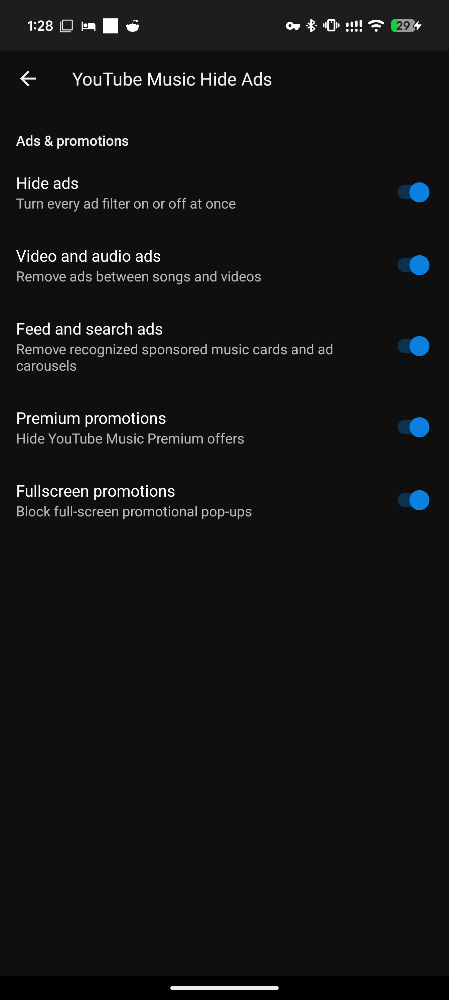
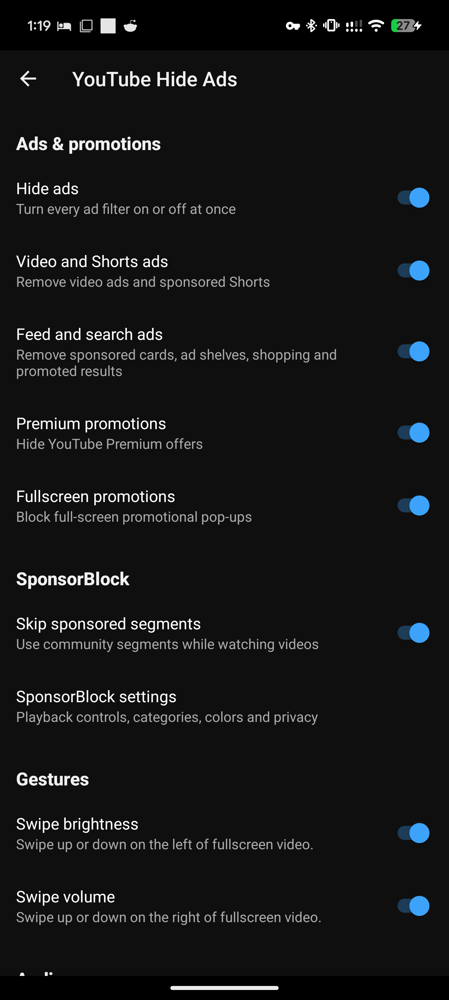

# YouTube Music Hide Ads, build 158

Acceptance completed 2026-11-16 (Malaysia time), following development on 2026-11-15.
This is a development increment for the Hide Ads part of issue #5. No release was published.
Existing dated evidence is unchanged.

## Identities and construction

[Build record](build.json) pins the canonical store, unsigned production-package APK, all 13 inputs
(11 native paths, third-party DEX, static branding), and separately signed device variants.
[Toolchain pins](../../toolchains.json) identify the native Windows compiler and AAPT2 inputs.
[Native transaction manifest](../../source/xax/transactions/music-ads-20261116/manifest.json)
records exact roots and carrier hashes. The canonical store is build 158 with both host scopes.
No native policy binary, ABI or third-party DEX changed.

**EXECUTED:** four native exact-root edits followed by verification; independent replay of the
checked-in LF-normalized carriers produced byte-identical final source. The published canonical
store passed native verification. Native resolve/build produced the unsigned APK; a native rebuild
was byte-identical. A stale-root transaction was rejected with `WORKSPACE-EXPECTED-ROOT`.
All final replay/build processes set `XAX_REQUIRE_NATIVE=1` and invoked the pinned PE compiler
directly. The SDK's use elsewhere was read-only inspection and metadata/record serialization.
[Normalized replay](normalized-replay-result.json), [native rebuilds and stale rejection](native-rebuild-result.json).
The latter includes an earlier MusicDev v8 signed rebuild; [final v9 rebuild](final-device-rebuild.json)
separately identifies the final device APK.

**MEASURED:** both final device variants have identical application DEX, every function CID and all
static resources (including `resources.arsc`) to the unsigned production-package APK. Their test
manifest/package/scope/version and signing identities differ. Resource names keep the production
namespace expected by the existing shared resource getter. This preserves the original installed
release and its settings; it is not a release-signature installation test.

## Physical device results

[Device](device.json): Pixel 8 Pro, Android 17/API 37, arm64, Vector 2.2/API 102.
Music 9.45.51 and YouTube 21.45.88; no emulator was used.

**EXECUTED, Music:** all 26 new policy cases plus the shared 70 ad cases pass through the packaged
native boundary. The success branch incorporates the shared result; its log labels the 26 additional
cases. Component, typed own-element serializer, fullscreen and boolean activation discovery succeed.
Music installs its ad/settings hooks without starting YouTube player, Shorts or SponsorBlock features.

**EXECUTED, Music settings:** native Account → Settings entry, ads-only page with five switches,
all-on state, master-off persistence and the nine-byte snapshot `[0,1,1,1,1,0,0,0,0]` before application
`onCreate`, then independent category-off persistence `[1,0,0,0,0,0,0,0,0]`. All switches restored on;
Back returns to Music settings; no crash in captured sessions. Music uses its own preferences.
YouTube's preference-file SHA-256 stayed unchanged. The final run reused saved preferences; it was
not a data-clear test. [Settings results](device-settings-result.json),
[all-on log](music-defaults.log), [master-off log](music-master-off-startup.log),
[category-off log](music-individual-off-startup.log), [accepted UI log](music-accepted-ui.log).

**MEASURED, Music playback:** an ordinary link launch generated a real true activation argument;
the installed hook logged `Music video ad activation suppressed`. The time bar advanced from
0:09 to 0:24 while Music's media session reported PLAYING. Playback was paused afterwards.
This demonstrates a positive activation-hook effect and playback progression, not audible-output
measurement or proof that a server-delivered ad would otherwise play.
[Playback log](music-playback.log), [scoped observations](playback-observations.json).

**EXECUTED, YouTube regression:** 664 startup cases and the existing 64-case SponsorBlock settings
UI suite pass on the same application graph. The unified native settings page opens and Back works;
preferences remain unchanged. Original feature hooks install; ad suppression/component replacements
are logged. The production module was restored enabled, and the temporary YouTube regression module
was disabled and uninstalled. [Result](youtube-regression-result.json), [log](youtube-regression.log).
This is a focused startup/settings regression, not a repeat of every historical player test.

Final device state: the separate Music development module remains installed and enabled for Music
only, all five switches on, playback paused. The existing production module remains enabled for YouTube.

## Limits and rejected attempts

**NOT RUN:** natural Music feed/search, compact/Premium component and fullscreen promotion delivery;
blank-space/layout outcomes for those removals; light theme; other devices, frameworks or Music
versions. The compact parent-only/nonzero-path exclusions and native-false preservation are structural
contracts reviewed in the graph; they were not separately driven through a controlled installed hook.
Startup fixtures are not naturally served positives. No Music SponsorBlock or player/feed extras are added.
Native Upgrade/Get Music Premium entries and unrecognized native Premium bottom sheets remain.

**NOT RUN:** release signing and a release-signed dual-host installation. The matching private signing
capability was unavailable/locked. The unsigned production-package APK and separate development
packages are distinguished in the build record; no signing material is committed.

Earlier development attempts exposed Music lifecycle/theme assumptions, uninitialized shared dialog
state and YouTube-only color-picker checks. Those paths were corrected before final acceptance.
An early test package renamed the resource namespace and broke YouTube resource lookup; final test
packages rename only the manifest package and retain identical production resources. The first final
Music rerun was interrupted in Android notification settings; the complete rerun recorded here passed.
No rejected attempt is counted as a passing result.
