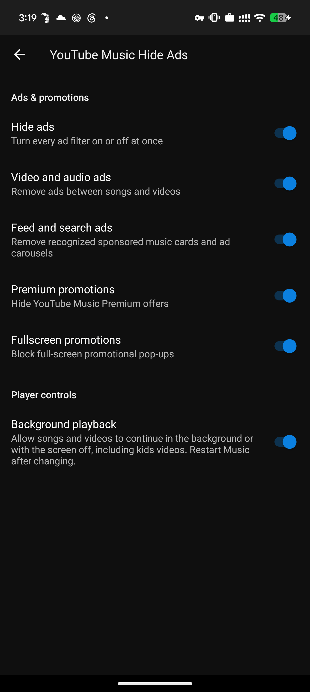
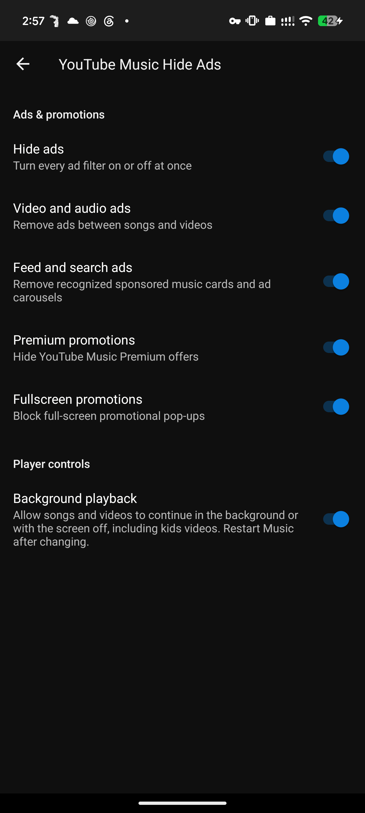

# Music background playback, build 159

Physical-device acceptance on 2026-11-16 (Malaysia time). This is a development increment following
Music ad build 158, not a published release. Existing dated evidence is unchanged.

## Final guarded revision

The current canonical source includes the fifth transaction, which isolates unexpected background
discovery exceptions using YouTube's synchronous completed-future startup pattern. Its native
replay and stale-root rejection are in [final native checks](final-native-checks.json). The final
source has 508 functions; its eligibility callback, kids callback and installer retain their exact
initial-candidate CIDs. [Final build record](final-build.json) supersedes the initial build record
for current artifact identities. All four DEX files and static resources match between its unsigned
production APK and both signed development APKs; native inputs remain unchanged.

**EXECUTED on the final APK:** Music's 108 startup checks, disabled preference persistence and
pause-on-Home, background authorization with Hide ads off, ordinary Home/screen-off playback and
preservation of a manual pause on foreground return.
[Final Music checks](final-music-checks.json), [streamed scoped log](final-music.log),
[startup log](final-startup.log). The recorded native pause positions are **29,054 ms** then
**29,496 ms** after returning foreground, both PAUSED; the screen-off interval has Dozing on both sides.
The next navigation encountered an open notification shade; the completed checks are retained and
the kids/final-settings check resumes separately, without counting the interrupted navigation.

**EXECUTED on the final APK:** Baby Shark/Pinkfong title confirmation, Dozing on both sides of a
PLAYING screen-off interval, native pause at **30,084 ms**, kids-policy authorization, all six switches
restored on and Back navigation. [Final kids/settings checks](final-kids-playback.json),
[scoped log](final-kids-playback.log). The same limitation about server-side Made for Kids metadata
applies as in the initial-candidate section below.

[Final YouTube regression](final-youtube-regression-result.json) and
[scoped log](final-youtube-regression.log) record the repeated 664 startup cases, 64 settings UI
cases, settings navigation, unchanged preferences and restoration of the production module.
[Final device audit](final-device.json) binds the installed Music APK digest to the built final
variant and records the restored device state. Forced exception/partial-install injection is
**NOT RUN**; native verification and graph review cover exception containment, and the normal
guarded path is exercised on the device.

The following initial-candidate records remain unchanged. Their JSON hashes, samples and APK
identities describe the first four transactions, before the startup guard was added.

## Source and build

[Build record](build.json), [central toolchain pins](../../toolchains.json) and the
[native transaction manifest](../../source/xax/transactions/music-background-20261116/manifest.json)
identify the canonical source, unsigned production-package APK, separately signed development APKs,
inputs and exact-root edits. The native Windows compiler is the released seed in the pinned latest
XAX main; XAX-MCP was inspected but grants no mutable store. BBC was inspected and not rebuilt or
invoked: BF commands and the shipped native ABI are unchanged.

**EXECUTED:** native edits and mandatory verification at all four stages; independent replay of the
checked-in carriers produces byte-identical final source. A stale-root request rejects with
`WORKSPACE-EXPECTED-ROOT`. Native resolve/build produces the unsigned APK; native resolve/build-signed
produces both development variants. Every operation invokes the pinned native PE directly with
`XAX_REQUIRE_NATIVE=1`; there is no interpreter fallback. The SDK only inspects semantic objects and
serializes declarations, metadata and records. [Checks](native-checks.json).

**MEASURED:** the production and both development variants have identical application DEX, all four
DEX files and all static resources, including `resources.arsc`. The 11 native libraries and third-party
DEX match the previous pinned inputs byte for byte. Manifest package/scope/version and signing
authority differ for the development variants. [Variant comparison](variant-comparison.json).
The source retains the shared BF gate, preference reader, UI scaffold/rows, hook installer, bounded
caller deoptimizer, Music ad page and YouTube background installer function CIDs.

## Physical Music checks

Pixel 8 Pro, Android 17/API 37, arm64, Vector 2.2/libxposed API 102, Music **9.45.51**.
The existing separate `musicdev` package was updated with its existing development signer and Music-only
scope. It contains the same application code as the unsigned production-package APK.

**EXECUTED:** both background methods resolve uniquely, pass reflection/deoptimization and install.
All 12 new packaged checks pass: eight AND3 cases through the actual BF/JNI boundary and four host
classifier cases. Music's existing 96 ad checks also pass. Both authorization paths are observed.
The known obfuscated methods printed in logs are observations, not selectors. [Startup log](startup.log).

**EXECUTED:** the shared native page shows Background playback under Player controls, default on.
Turning it off persists across restart; an ordinary playback link then pauses on Home without a
background authorization. With Background playback on and Hide ads off, a cold start retains those
independent settings, and Home remains PLAYING with eligibility authorization logged.
[Completed settings/independence checks](settings-and-independence.json),
[disabled log](disabled-playback.log), [ad-master-off log](master-off-playback.log).

**MEASURED, ordinary playback:** after a deliberately launched ordinary link, Home and the verified
screen-off interval retain Music's PLAYING state. Power state is Dozing before and after the interval
(the phone's always-on display). A native media pause reports position **29,051 ms**; returning to
the foreground remains PAUSED at **29,212 ms**. The module sends no playback command.
[Samples and power states](ordinary-playback.json), [streamed scoped log](ordinary-playback.log).

**MEASURED, kids-content check:** the requested Baby Shark link displays **Baby Shark / Pinkfong**.
Music remains PLAYING with power state Dozing before and after the screen-off interval. A native
pause reports **24,079 ms**; the kids-controller authorization is observed in the same process.
This is a real kids-content playback observation, not an inspection of a server-side Made for Kids
metadata bit. [Samples/title/settings](kids-playback.json), [scoped log](kids-playback.log).

**EXECUTED:** all six switches are restored on, the page Back action returns to Music settings,
and playback is paused after the playback checks. The final device audit after regression finds
Music's session STOPPED. [Device and installed APK identity](device.json). Preferences remain package-local. The separate YouTube regression report
records the before/after hash check for YouTube's existing preference file.

## YouTube regression

YouTube **21.45.88** is checked using a temporary development package with identical application DEX.
[Regression result](youtube-regression-result.json) and [scoped log](youtube-regression.log) record
startup suites, the 64-case settings UI check, the shared settings page and Back navigation. The
production module is restored enabled and the temporary YouTube test module is disabled/uninstalled.
This is focused startup/settings coverage, not a repeat of every historical YouTube feature test.

## Rejected attempts and limits

An initial combined caller/lifecycle rewrite failed mandatory verification because it retained an old
dependency reference. The final authoring separates those changes into exact-root stages and rebinds
their handles. A later unsigned build attempt retained a signed artifact request and was rejected;
the unsigned review request and signed development requests are explicit separate packaging edits.
Neither rejected artifact was installed or published as source.

Earlier device drivers incorrectly required Asleep instead of the phone's AOD Dozing state, encountered
a wake during an attempted interval, and queried startup logs after the logcat ring had discarded them.
The final accepted playback observations record power state on both sides and retain streamed
PID-scoped logs. Interrupted intervals and missing ring-buffer lines are not counted as acceptance.
The test driver also uses Android's ordinary keyguard dismissal when returning to the app.

**NOT RUN:** audible-output measurement, real Bluetooth controls, incoming calls/audio-focus
interruptions, long-duration playback, other versions/devices/frameworks, light theme, translated new
summary text, forced missing/ambiguous resolver cases, injected partial-install/native-policy failures,
null-argument integration cases, and Music-specific reset UI. Those failure paths are contracts and
graph checks, not forced device positives. Morphe's separate recycled-bitmap metadata fix is not
adapted, and broader notification/bitmap stress is untested. No Music SponsorBlock is added.

**NOT RUN:** release signing and a release-signed dual-host installation; the matching private signing
capability was unavailable. The tested Music development package remains installed and enabled only
for Music. No release, emulator result or performance improvement is claimed.
