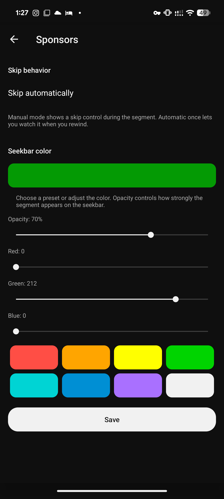
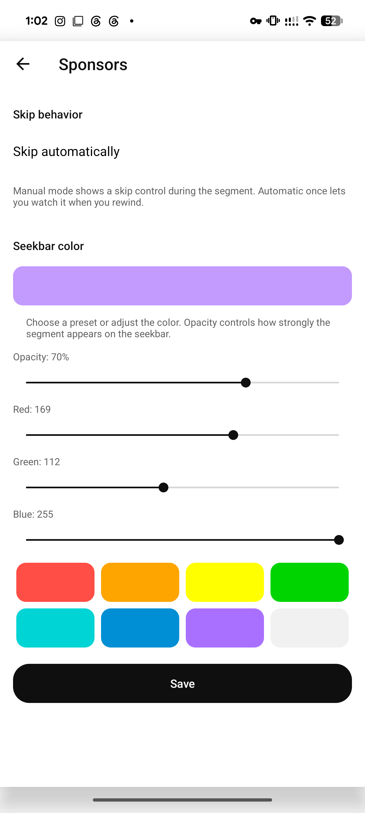
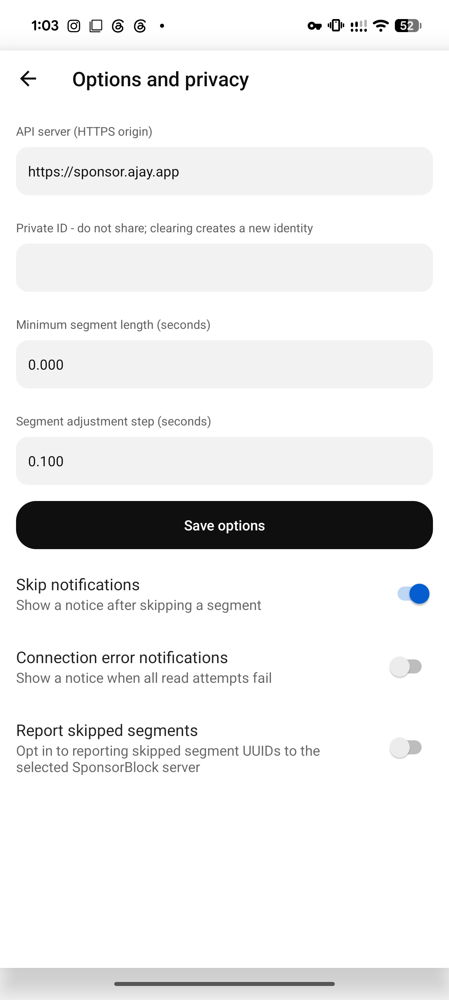
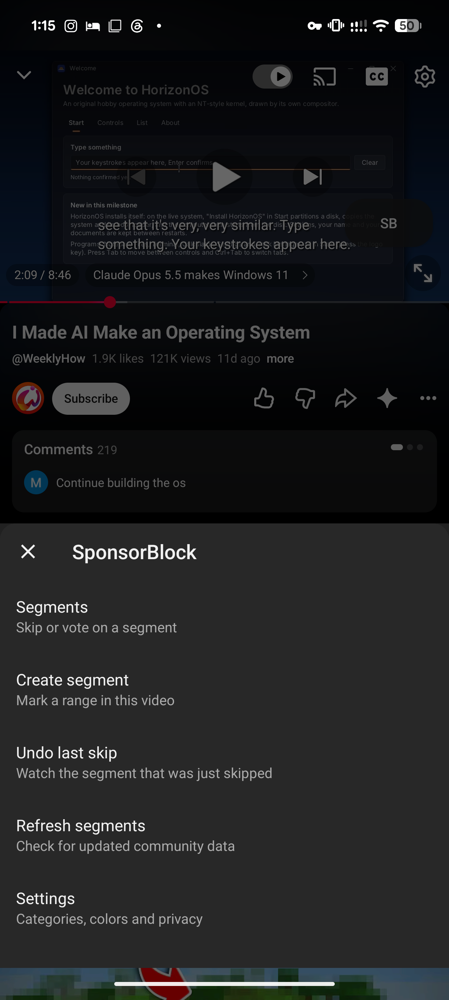
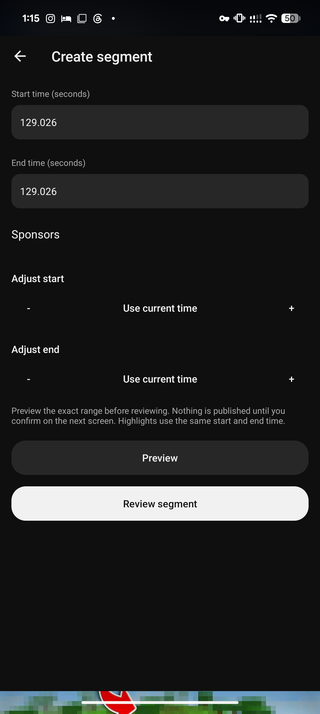
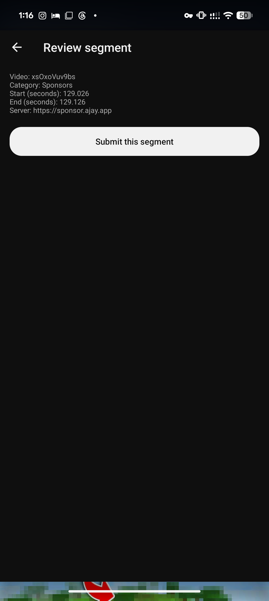

# SponsorBlock UI, 2026-10-22

Version **1.2.0, code 123** uses the current YouTube design for SponsorBlock controls and settings.
[Build identity](build.json), [input/toolchain record](toolchain.json), and [preservation check](preservation.json)
identify the exact store and installed APK. Target: Pixel 8 Pro, Android 17/API 37, Vector 2.2/API 102,
YouTube **21.42.243**. This does not certify older YouTube versions.

## What changed

Shared XAX functions reuse YouTube's preference layout, text appearances, navigation icons, rounded
shapes and theme attributes by name. Settings use full pages with Back navigation; the player opens
a compact bottom sheet. Fields, switches, selectors, actions, segment lists, draft/review screens,
statistics, exclusions and settings transfer use the shared presentation.

Category colors have a live preview, eight presets, and red, green, blue and opacity sliders.
There is no visible hex-code editor. Presets preserve opacity; saved ARGB values and desktop
settings transfer retain their existing format. All sliders and adjustment controls have 48 dp touch areas.
The normal player button follows native controls visibility; the manual-skip prompt keeps its existing overlay.

No dependencies were added. The BF policies, all 11 packaged native libraries, third-party DEX pin,
signer, retrieval, API authorization and settings format are unchanged. Of 230 existing functions,
203 retain identical typed graphs; 31 UI functions are added. The other changes concern presentation,
navigation, UI state/feedback and the corrected version footer.

## Checks

- The exact installed final APK matches its build SHA-256. All **636 startup checks** and **28 live-context
  UI checks** pass in the final build; see [filtered runtime log](runtime.log).
- Light and dark themes, native selection dialogs, keyboard opening/resizing, navigation and all
  settings forms were exercised during candidates 120/121. The final 123 retains those exact shared
  UI functions from 121. Only the editor's clipped step-row layout changes after 121.
- A purple preset saves as `#B3A970FF`, retaining its exact original opacity and skip mode. The saved
  values survive a cold start/package update. Manual mode selection also saves through the native
  choice dialog. [Save check](picker-save-check.json).
- Native player hide/show retains one control and produces no duplicates on layout changes.
  [Visibility check, 121](player-visibility.json). The corresponding functions are unchanged in 123.
- Candidate 122 exercises the final editor's start/end adjustment, preview and review. All four arrow
  controls are fully inside the screen with 48 dp hit regions. Preview closes the SponsorBlock pages
  and returns to playback; the subsequent review shows the exact range/category/server and is canceled.
  [Layout measurements](draft-layout-check.json). The final 123 retains this exact editor function.
- Original module preference-file absence and YouTube's **Use device theme** selection are restored.
  Only three test-created preference keys existed before removal; no unrelated preferences were removed.
  [Restoration record](restoration.json). Test draft state is discarded by the final cold start.

The interrupted fullscreen/landscape attempt is **not accepted as evidence**: the phone moved to Android
settings and the capture did not establish a stable landscape menu. No production submission, vote,
username change or view-report POST was sent. Other devices, locales, large font settings and a full
landscape/RTL matrix remain unverified. The platform gesture-navigation area can remain transparent
when a page is opened over the player.

Raw logs and original captures remain local under
`D:/Android/AndroidStudioProjects/Logs/YouTubeHideAds_UI_20261022`.
The shell/Python carrier and ADB test transport stayed outside the repository; application source is XAX/BF.

## Screens

Final 123 color picker, with the original default color restored:

Light appearance and keyboard-compatible field styling, candidate 121 (same final UI functions):

Player sheet and corrected editor, candidate 122 (same final functions):

